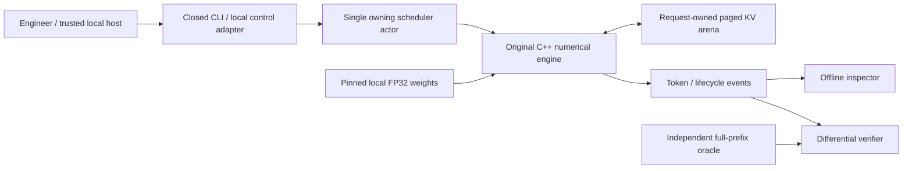
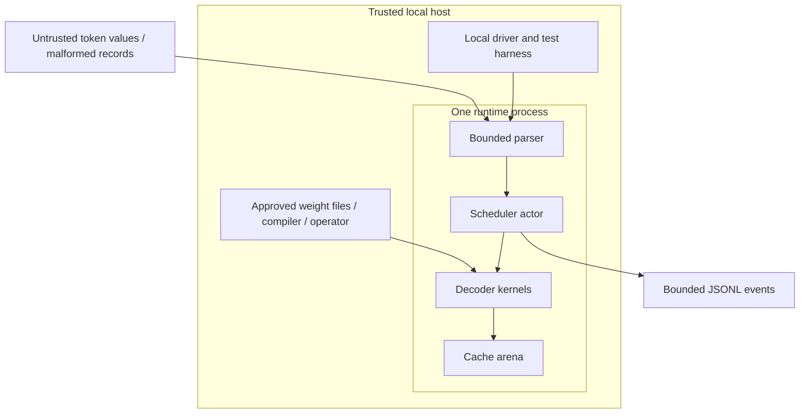
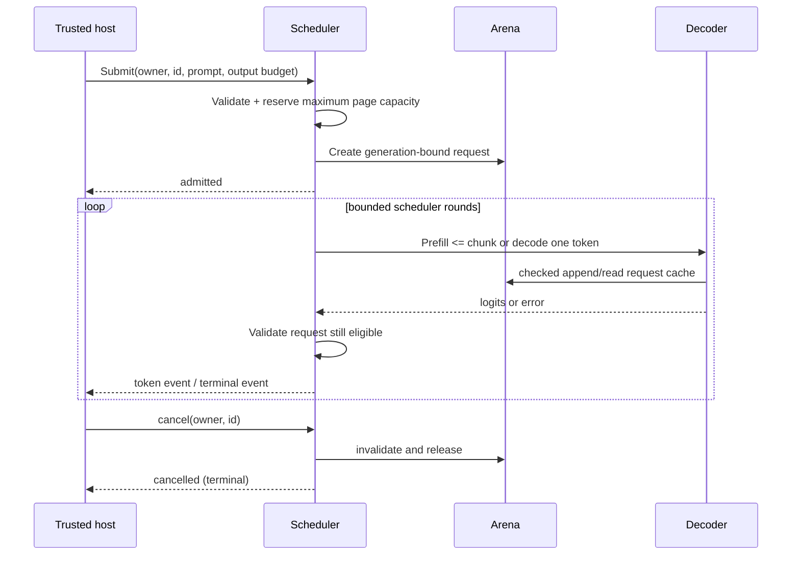
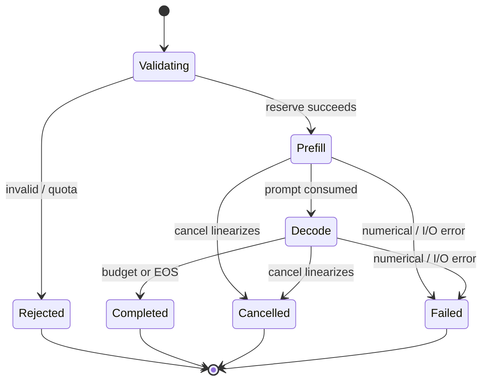
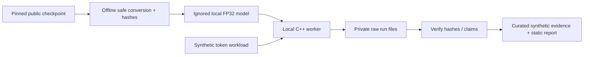
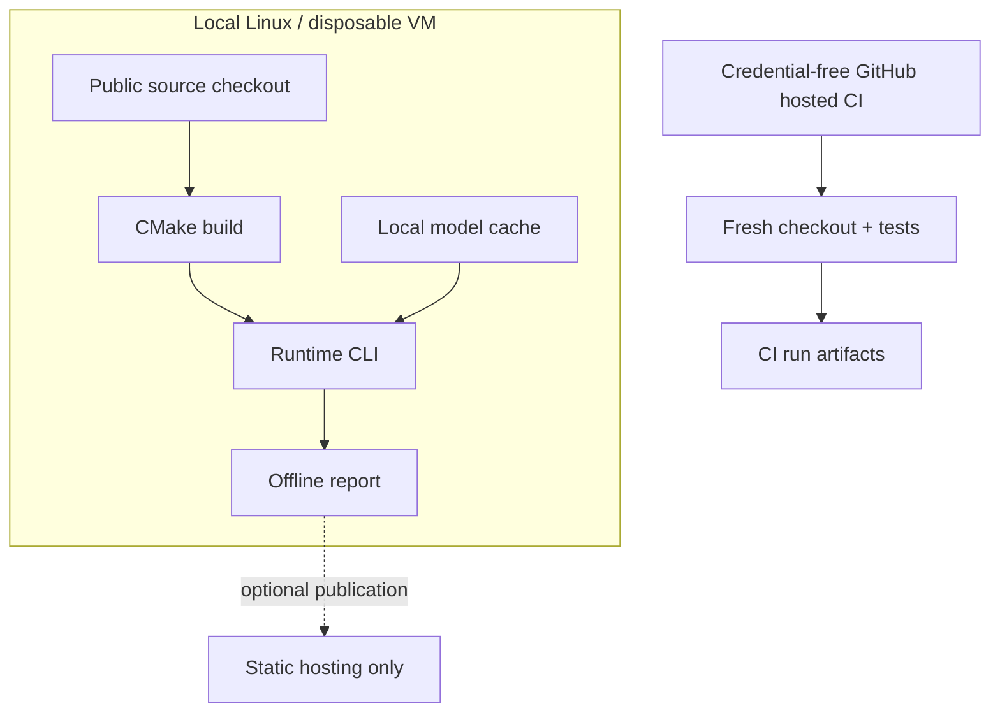

# Architecture

This document specifies the complete target; current implementation and verification status is recorded in [verification/criterion_status.json](verification/criterion_status.json). An implementation diagram is not evidence of completion.

## Context and component ownership

The C++ core owns model weights, numerical execution and cache state. The final C++ scheduler owns request state and is the only mutator of the cache. Python owns offline fixture/model preparation, independent numerical oracle, load generation, verification and report rendering. There is no database, message broker, Kubernetes cluster, LLM API or external agent runtime.

The seed can expose a pure numerical CLI before the scheduler is complete. Its cached attention is not by itself a multi-request paged arena. This distinction must remain explicit in code and claims.

## Boundaries and runtime topology

The host, compiler, engine process and authorized model source are trusted. Client values are untrusted data; they cannot name a file, execute a tool or supply an authority context. A host that owns the process can read all cache memory. Request isolation is a logical/runtime property, not process isolation or a cryptographic confidentiality guarantee. Do not expose the native control interface to the Internet.

## Model mathematics and tensor layout
The supported model family uses tied token embedding/output weights, RMSNorm, rotary positional encoding with split-half rotation, grouped-query attention, a causal mask and a SwiGLU feed-forward block. Weight matrices are row-major `[out,in]`; vectors are FP32. Reference accumulations may use FP64 for diagnosis; production precision and math flags must be recorded. No fast-math in the correctness baseline.

For each layer: normalize x; project Q,K,V; rotate Q and K using the absolute position; append K,V to that request's cache; attend only to positions <= current; project concatenated heads; add residual; normalize; apply silu(gate(x))*up(x); down-project and add residual. Final RMSNorm and tied embedding projection produce logits. GQA maps query head h to KV head floor(h/(H/KV)). Greedy selection uses lowest token ID on an exact tie. Softmax subtracts the maximum before exponentiation. Reject nonfinite outputs; do not silently clamp evidence errors away.

SmolLM2-135M profile: D=576, FF=1536, L=30, H=9, KV=3, head dimension=64, vocabulary=49152, RMS epsilon=1e-5, RoPE theta=100000; public upstream max length is 8192, but this project intentionally caps total positions at 256. Check the pinned config again during conversion. Synthetic fixtures use much smaller dimensions and are not language models with demonstrated usefulness.

## State ownership, consistency and memory
Weights are immutable after load. Each request has `(session_id, request_id, generation, owner)` and a private logical-position to physical-page table. Each page stores `[layer, K-or-V, page_token, kv_head, head_dim]`, an owner handle and generation. Page IDs are not authority tokens. Arena APIs check the owner/generation before returning spans. Destroying a request invalidates handles, clears pages before reassignment and returns the reservation exactly once.

A single actor orders submit, scheduler tick, cancel and completion publication. No lock-free queue or distributed consistency protocol is necessary. Generation counters must not wrap; refuse further allocations at exhaustion. Session identity changes on restart. The seed's simpler standalone cache is not accepted as evidence for this final ownership API.

## Critical execution sequence

In a single actor a control record is processed between compute steps. If a future asynchronous compute backend is added, dispatch captures the generation and every completion rechecks it before state/output commit. Cancellation acknowledgment, not physical kernel preemption, is the observable boundary. A request that completed before cancellation returns an already-terminal result; it is not retroactively cancelled.

## Scheduler and resource policy
Admission reserves ceil((prompt_length + max_new_tokens)/page_size) page credits. Default capacity is 16 live requests, 256 positions per request, 16 tokens per page and at most 256 MiB of KV payload. Use checked arithmetic for the model-dependent page byte size `2*layers*page_size*kv_heads*head_dim*sizeof(float)`. Metadata and weights are accounted separately. Full request reservation avoids late cache overcommit; it trades utilization for easier, defensible failure semantics.

The actor maintains an ordered ready deque. Each completed round offers every eligible request at most one prefill chunk (default4) or one decode step, in arrival order rotated after service. Cancellation/error/completion removes it from the deque. Fairness is a grant-count property for equal-weight decode requests, not a universal token-cost or latency theorem. Profile prefill and decode separately. There is no automatic retry of a numerically failed step.

## Lifecycle

Terminal events are emitted once. Request IDs are unique within a session; retry semantics are conservative: duplicate live IDs reject, and a bounded completed-ID ledger returns already-terminal without regenerating output. Maximum ledger entries=10000; new sessions are explicit when capacity is exhausted. This is not durable exactly-once delivery. On shutdown stop admission, process cancellation, release state and exit; on forced process termination in-memory work is lost.

## Data flow and deployment

There is no automatic migration of model formats; unknown versions are refused. API compatibility is explicitly versioned. Logs omit raw user text. Events include request ID, event kind, generation, step, monotonic elapsed timestamp and bounded numeric counters; traces are local evidence, not a telemetry collector. Metrics: admitted/rejected/cancelled/completed counts, live/reserved pages, grant counts and timing distributions. Alerts belong to the optional hosted wrapper, not the local numerical kernel.

## Removal test / material decisions
|Component|Requirement|Simpler option|Decision and property lost if removed|
|---|---|---|---|
|Original C++ decoder|FR-001|Wrap Transformers|Needed for inspectable model/math implementation; removing it eliminates the new signal.|
|Independent Python/Transformers oracle|FR-002/007|Self-comparison|Needed to detect shared cache/mask mistakes; self-agreement is insufficient.|
|Paged owner-aware arena|FR-003/SEC-003|Separate contiguous buffers|Study fragmentation and lifecycle; keep contiguous baseline to quantify its overhead.|
|Single scheduler actor|FR-004/005|Thread per request|Simplest explicit publication/cancellation order; no parallel writer races.|
|Offline report|FR-008|Raw JSON only|Small usability gain for reviewers, no frontend framework.|
|Safe converter + pinned model|FR-007|Pickle model loader|Avoid arbitrary deserialization execution and make real integration reproducible.|
|Machine evidence runner|PERF-001|Typed summary|Source/output identities and exit codes make claims inspectable, not fraud-proof.|
|No Postgres/Redis/Kafka/Kubernetes|No requirement|Add service stack|Removal loses no core property; therefore not included.|
