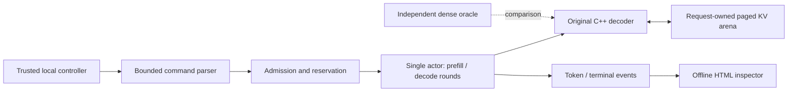

# BatchQuay
### Inspect the math. Bound the state. Explain the result.

An experimental **C++20 CPU transformer runtime** with request-owned paged KV state, bounded token scheduling, and an independent numerical oracle.

[Run locally](#run-locally) · [Architecture](ARCHITECTURE.md) · [Actual demo](docs/demo/report.html) · [Evidence](VERIFICATION_REPORT.md) · [Limits](LIMITATIONS.md)

> **Experimental implementation.** Check the [current criterion index](verification/criterion_status.json) and run `make release-verify` for full-release eligibility. A passing core suite alone is not approval. Real pinned-checkpoint numerical conformance, separate review, clean reproduction and complete publication auditing are mandatory. No production, generated-language quality or universal performance advantage is claimed.

## The engineering question
Can a small inference engine preserve numerical behavior while it interleaves requests, owns and reuses their cache pages, refuses excess work, and cancels execution without leaking state or committing later output?

| Numerical execution | Explicit ownership | Inspectable failure |
|:--|:--|:--|
| Original RMSNorm, RoPE, grouped-query causal attention and SwiGLU decoder. | Page handles bind session, subject, request, generation and allocation epoch. | Typed denial, cancellation, failure reclamation and fresh-session restart. |

The runtime uses FP32 storage/activations and FP64 reductions. The independent Python oracle recomputes complete prefixes with dense NumPy operations. This is neither a wrapper around a hosted model nor a replacement for llama.cpp, vLLM or SGLang.

## Run locally
Linux or Windows with GCC, GNU Make, CMake, Ninja, Python 3.12 and Git are supported verification hosts. The fixture and demo use the Python standard library. NumPy is needed for differential verification; Clang sanitizer campaigns require Linux.

```sh
make bootstrap       # Inspect prerequisites; does not install or alter the host.
make build
make demo            # Real child-process execution and an offline HTML report.
```

The demo prints `.local-runs/demo/report.html`. Open it locally to inspect admission, denial, prefill, cancellation and completion. The included [recorded report](docs/demo/report.html) is a synthetic execution, not a hosted application. GitHub may display HTML as source; the local file is the intended viewing path.

For a network-capable fresh environment:

```sh
python3 -m venv .venv
. .venv/bin/activate
python -m pip install --require-hashes --only-binary=:all: -r requirements-core.lock
make verify
```

The core lock covers CPython 3.12 Linux x86_64 and Windows AMD64 wheels. `requirements-reference-windows-cp312.lock` records all 35 resolved Windows CPU reference dependencies. Install that lock into a separate environment for real-model verification. The reference pins include Tokenizers 0.22.2, a published wheel compatible with Transformers 5.15.0. Fresh reproduction is a separate measured gate; read each receipt's environment and source identity.

## From token IDs to a bounded result



This is **interleaved token scheduling**, not a fused matrix-multiply batching backend. Equal decode grants are not equal wall-clock latency. The process deliberately exposes no network listener and does not authenticate owner labels.

## Verify what is claimed

```sh
make verify             # Core local checks; not full release approval.
make conversion-test    # Synthetic safetensors conversion; needs Torch/safetensors.
make sanitize lint      # Clang sanitizers and static analysis.
make mutation           # Selected PASS -> FAIL -> PASS negative controls.
make benchmark          # Six paired workloads, 1/2/4/8/16 requests, >=5 repetitions; native RSS and round-visible timing.
make clean-verify       # Fresh committed clone plus fresh hash-locked dependency environment.
make security-online    # Requires actual installed vulnerability/secret scanners.
make fetch-model real-model  # Mandatory real-checkpoint gate; network/deps required.
make release-verify     # Intentionally refuses incomplete release evidence.
make publication-verify # Scan complete current export and all referenced history; needs gitleaks.
```

[Verification](VERIFICATION_REPORT.md), [criterion mapping](TEST_MATRIX.md), [claims](CLAIMS_EVIDENCE.md) and [release readiness](RELEASE_READINESS.md) distinguish executed checks from blocked or unmeasured work. A receipt binds source and output bytes; it is not independent attestation.

## Deliberate limits
A trusted process and OS own all data. Page ownership protects the engine's validated access paths; it does not sandbox arbitrary native code, authenticate remote users, stop timing inference or guarantee confidentiality against the host. Models have a 256-position runtime cap, bounded file/dimension checks, and greedy token selection. Request-ID reuse follows the independently assessed [terminal-replay exception](TEST_SPEC_EXCEPTION_TERMINAL_REPLAY.md): retries can create a new generation; there is no completed-result ledger. No training, GPU, distributed service, quantization, shared prefix cache or production availability is claimed.

## Read the source

| Concern | Entry point |
|:--|:--|
| Checked weights and numerical execution | `src/model.cpp`, `src/model.hpp` |
| Arena, ownership, epochs and initialized lengths | `src/cache.cpp`, `src/cache.hpp` |
| Reservation, rounds and terminal paths | `src/scheduler.cpp`, `src/main.cpp` |
| Independent reference and deterministic fixtures | `tools/reference.py`, `tools/fixture.py` |
| Native tests and actual process checks | `tests/native_tests.cpp`, `tests/test_system.py` |
| API, threat model and operations | [API](API_SPEC.md), [threats](THREAT_MODEL.md), [operations](OPERATIONS.md) |

Original source is [MIT licensed](LICENSE). Model and dependency rights remain separate; see [third-party notices](THIRD_PARTY_NOTICES.md). Contributions should preserve the [locked behavioral contract](ACCEPTANCE_SPEC.md).

Browser report checks use a separate environment installed with `python -m pip install --require-hashes --only-binary=:all: -r requirements-browser.lock`, then `python -m tools.browser_check --executable <installed-chrome-path>`. `make security-online` accepts `BQ_REFERENCE_PYTHON`, `BQ_BROWSER_PYTHON` and `BQ_PIP_AUDIT_PYTHON` for the three isolated environments.
