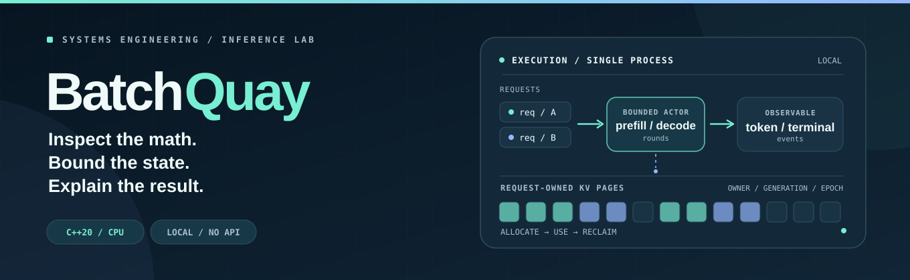
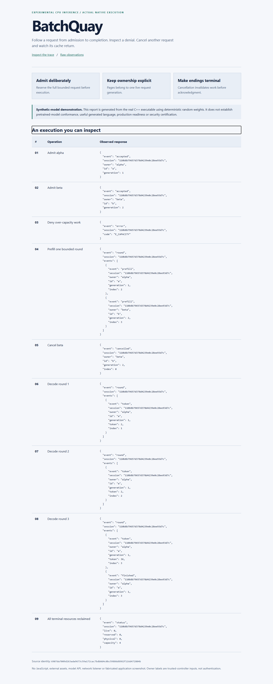
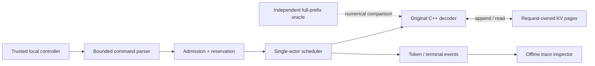

<p align="center">
  <picture>
    <source media="(prefers-color-scheme: dark)" srcset="assets/hero-dark.svg">
    <source media="(prefers-color-scheme: light)" srcset="assets/hero-light.svg">
    
  </picture>
</p>

<h1 align="center">BatchQuay</h1>

<p align="center">
  <a href="https://github.com/C-X1an/batchquay/actions/workflows/core.yml"></a>
  <a href="CMakeLists.txt"></a>
  <a href="LICENSE"></a>
  <a href="LIMITATIONS.md"></a>
</p>

<p align="center">
  <strong>Inference mechanics, not an inference API wrapper.</strong><br>
  An experimental <strong>C++20 CPU transformer runtime</strong> with original decoder math,<br>
  request-owned paged KV memory, bounded token scheduling and independently checked numerical behavior.
</p>

<p align="center">
  <a href="#quickstart">Quickstart</a> &nbsp;·&nbsp;
  <a href="#watch-a-real-execution">Demo</a> &nbsp;·&nbsp;
  <a href="#how-it-works">Architecture</a> &nbsp;·&nbsp;
  <a href="#proof-before-promises">Evidence</a> &nbsp;·&nbsp;
  <a href="#deliberate-boundaries">Boundaries</a> &nbsp;·&nbsp;
  <a href="docs/README.md">Docs</a>
</p>

---

## A small runtime. A difficult set of invariants.

A transformer can produce plausible logits while mishandling cache positions, sharing request state, admitting work it cannot finish, or continuing after cancellation. BatchQuay makes those properties **observable and testable**, rather than hiding them behind a hosted model endpoint.

| **01 / Compute** | **02 / Own** | **03 / Account** |
|:--|:--|:--|
| Original RMSNorm, rotary embeddings, grouped-query causal attention and SwiGLU, checked against a separately expressed reference. | Cache pages tied to session, subject, request generation and allocation epoch; reuse clears previous state. | An actor interleaves bounded prefill/decode rounds, rejects over-capacity work and emits terminal events. |

The engine uses FP32 weights/activations with selected FP64 reductions. It is **single-process token interleaving**, not fused GPU batching, a hostile-code sandbox or a production replacement for established inference engines.

## Watch a real execution

The included report was generated from the **real native child process** using deterministic *synthetic* weights. Follow two requests through admission, over-capacity denial, prefill, cancellation, decoding and final reclamation.

<table>
  <tr>
    <td width="50%" valign="top">
      <strong>Observe the lifecycle</strong><br><br>
      <code>ADMIT</code> → <code>PREFILL</code> → <code>DECODE</code> → <code>TERMINAL</code><br><br>
      See the actual <a href="docs/demo/desktop.png">desktop capture</a> and <a href="docs/demo/mobile.png">mobile capture</a>, inspect the <a href="docs/demo/trace.json">raw trace</a>, or read the <a href="docs/demo/README.md">guided walkthrough</a>.
    </td>
    <td width="50%" valign="top">
      <a href="docs/demo/desktop.png"></a><br>
      <sub>Actual native demo capture · synthetic model · no hosted service</sub>
    </td>
  </tr>
</table>

The committed [offline HTML report](docs/demo/report.html) is a recorded artifact; GitHub may show its source rather than render the interactive document. Open the generated local `report.html` to explore it in a browser.

## Quickstart

**Requirements:** Linux or Windows with GCC, GNU Make, CMake, Ninja, Python 3.12 and Git. The demo itself uses Python's standard library; NumPy and separate reference packages are required for deeper verification.

```bash
git clone https://github.com/C-X1an/batchquay.git
cd batchquay

make bootstrap     # Inspect prerequisites; does not change the host.
make build         # Compile the native C++20 executable.
make demo          # Run a real child process and write an offline report.
```

Open **`.local-runs/demo/report.html`**. You do not need a cloud account, GPU, API key or downloaded model weights for this demonstration.

For the hash-locked core Python environment on supported platforms:

```bash
python3 -m venv .venv
. .venv/bin/activate
python -m pip install --require-hashes --only-binary=:all: -r requirements-core.lock
make verify
```

The core lock targets CPython 3.12 on Linux x86_64 and Windows AMD64. The pinned-checkpoint workflow has a **separate** reference environment; see [operations](OPERATIONS.md) and the [dependency notices](THIRD_PARTY_NOTICES.md) before attempting it.

## How it works



The host decides what may enter; the scheduler decides whose next bounded step runs; the decoder operates on request-owned state; terminal paths reclaim it. There is **no remote listener** and request subject labels are **not authenticated identities**.

<details>
<summary><strong>Inspect the implementation by subsystem</strong></summary>

| Subsystem | Start here |
|:--|:--|
| Numerical execution and checked model format | [`src/model.cpp`](src/model.cpp) · [`src/model.hpp`](src/model.hpp) |
| Page ownership, epochs, initialization and reclamation | [`src/cache.cpp`](src/cache.cpp) · [`src/cache.hpp`](src/cache.hpp) |
| Actor, admission, grants and cancellation | [`src/scheduler.cpp`](src/scheduler.cpp) · [`src/main.cpp`](src/main.cpp) |
| Independent oracle, fixtures and model conversion | [`tools/reference.py`](tools/reference.py) · [`tools/fixture.py`](tools/fixture.py) · [`tools/convert_model.py`](tools/convert_model.py) |
| Native and child-process regression tests | [`tests/native_tests.cpp`](tests/native_tests.cpp) · [`tests/test_system.py`](tests/test_system.py) |
| Contracts, design choices and data formats | [Architecture](ARCHITECTURE.md) · [API](API_SPEC.md) · [Decisions](DECISIONS.md) |

</details>

## Proof before promises

The dated, source-bound [criterion index](verification/criterion_status.json) records 24 locked criteria and a **`RELEASE_READY`** decision for its referenced technical source. The latest core [CI runs](https://github.com/C-X1an/batchquay/actions/workflows/core.yml) are independently visible on GitHub. **Neither historical approval nor a core CI badge automatically qualifies a newer presentation-only commit**; rerun `make release-verify` before claiming full-release eligibility for a new source identity.

| Recorded observation | What it actually supports |
|:--|:--|
| **20 fixed sequences · 326 positions** | Pinned SmolLM2-135M numerical comparison to independent Transformers eager CPU FP32. |
| **311 / 311** | Matching top-1 tokens *only* at positions meeting the recorded confidence-margin condition. |
| **6 workloads · 90 measurements** | Paired synthetic performance comparisons across three variants and up to 16 requests, not pretrained serving throughput. |
| **24 locked criteria** | A documented, evidence-linked release assessment for its stated source and environment, not production certification. |

Performance results are kept even when unfavorable. No universal paged-cache speedup, useful text generation quality, real user traffic, security certification or production availability is claimed. Read the actual [verification report](VERIFICATION_REPORT.md), [benchmarks](BENCHMARKS.md), [claims map](CLAIMS_EVIDENCE.md) and [release gate](RELEASE_READINESS.md).

<details>
<summary><strong>Verification commands and what they cover</strong></summary>

```bash
make verify             # Core build, tests, contracts and demo; not release approval.
make conversion-test    # Synthetic safetensors conversion.
make sanitize lint      # Sanitizers and static checks (supported Linux environment).
make mutation           # Targeted PASS -> FAIL -> PASS negative controls.
make benchmark          # Paired synthetic workload measurements.
make clean-verify       # Fresh committed checkout and hash-locked dependencies.
make fetch-model real-model   # Pinned checkpoint conformance; network and packages needed.
make security-online    # Installed online scanners required.
make publication-verify # Public export/history audit; gitleaks required.
make release-verify     # Source-bound release eligibility gate.
```

Published command receipts bind inputs, exits and output hashes to a source identity; they are not cryptographic attestation by an independent authority. See the [evidence index](verification/evidence_index.json) and [test matrix](TEST_MATRIX.md).

</details>

## Deliberate boundaries

> [!IMPORTANT]
> **Experimental trusted-host runtime, not an Internet service or a hostile-code sandbox.** The page checks protect validated engine access paths; they do not isolate arbitrary native code or conceal data from the process owner.

The runtime caps the supported context at 256 positions, uses greedy token selection and has no GPU kernels, distributed serving, quantization, prefix-sharing or authentication. A reused request ID begins a new generation rather than replaying a stored completed result; see the independently assessed [terminal-replay exception](TEST_SPEC_EXCEPTION_TERMINAL_REPLAY.md). [Threat model](THREAT_MODEL.md) and [limitations](LIMITATIONS.md) enumerate the other boundaries.

## Explore the repository

| **Understand the system** | **Reproduce the evidence** | **Review the constraints** |
|:--|:--|:--|
| [Architecture](ARCHITECTURE.md) | [Demo walkthrough](docs/demo/README.md) | [Threat model](THREAT_MODEL.md) |
| [API and file formats](API_SPEC.md) | [Verification report](VERIFICATION_REPORT.md) | [Security policy](SECURITY.md) |
| [Product requirements](PRD.md) | [Benchmarks](BENCHMARKS.md) | [Limitations](LIMITATIONS.md) |
| [Design decisions](DECISIONS.md) | [Acceptance criteria](ACCEPTANCE_SPEC.md) | [Release readiness](RELEASE_READINESS.md) |
| [Docs field guide](docs/README.md) | [Published evidence](verification/published/README.md) | [Contributing](CONTRIBUTING.md) |

<p align="center">
  <sub>Original code: <a href="LICENSE">MIT</a> · External dependencies and model weights retain their own <a href="THIRD_PARTY_NOTICES.md">licenses</a> · Local-first, no hosted-model API</sub><br><br>
  <strong>Make the computation inspectable. Make the failure path explicit.</strong>
</p>
