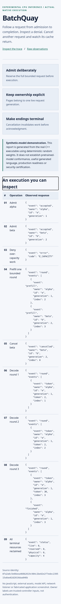

<p align="center">
  
</p>
<h1 align="center">An execution you can inspect</h1>
<p align="center">
  <strong>Follow one real native process from admission to final reclamation.</strong><br>
  <a href="../../README.md">Project home</a> · <a href="report.html">Recorded report (HTML source on GitHub)</a> · <a href="trace.json">Trace JSON</a> · <a href="../README.md">Docs
  </a>
</p>

---

## The recorded scenario

The offline inspector uses deterministic **synthetic weights** and the actual C++ executable. It does **not** demonstrate meaningful generated language, a remotely deployed service, or pretrained-model conformance.

| Step | What to inspect |
|:--|:--|
| **01 / Admit** | Two live request generations are accepted with bounded reservations. |
| **02 / Refuse** | A third request is denied with a typed over-capacity error. |
| **03 / Interleave** | A bounded prefill round advances request state. |
| **04 / Cancel** | One request terminates and does not emit later tokens. |
| **05 / Reclaim** | The surviving request completes and the final resource counters are zero. |

## Run it, don't only view it

```bash
make build
make demo
```

Open the generated **`.local-runs/demo/report.html`** in a local browser. This is the intended reading experience; GitHub may present [the committed HTML](report.html) as source. Reproduction requires no account, model download, cloud credentials or JavaScript.

## Captured views

The images below are **actual browser captures** of the recorded native demonstration, not generated UI concepts. Use the linked originals to inspect small text.

<details>
<summary><strong>Desktop capture</strong> · open recorded image</summary>

[](desktop.png)

</details>

<details>
<summary><strong>Mobile capture</strong> · open recorded image</summary>

[](mobile.png)

</details>

The browser record is in [`browser-review.json`](browser-review.json). It reports actual sandboxed browser layout and keyboard checks; it is **not** a full accessibility certification or hosted-URL test.

## Next: inspect the proof

Read [the full verification report](../../VERIFICATION_REPORT.md) and [criterion index](../../verification/criterion_status.json) for precisely what each executed test establishes. Numerical pretrained-model conformance and performance evidence are separate from this synthetic demonstration.

<p align="center"><sub>Native execution · traceable state · bounded resources · explicit limits</sub></p>
